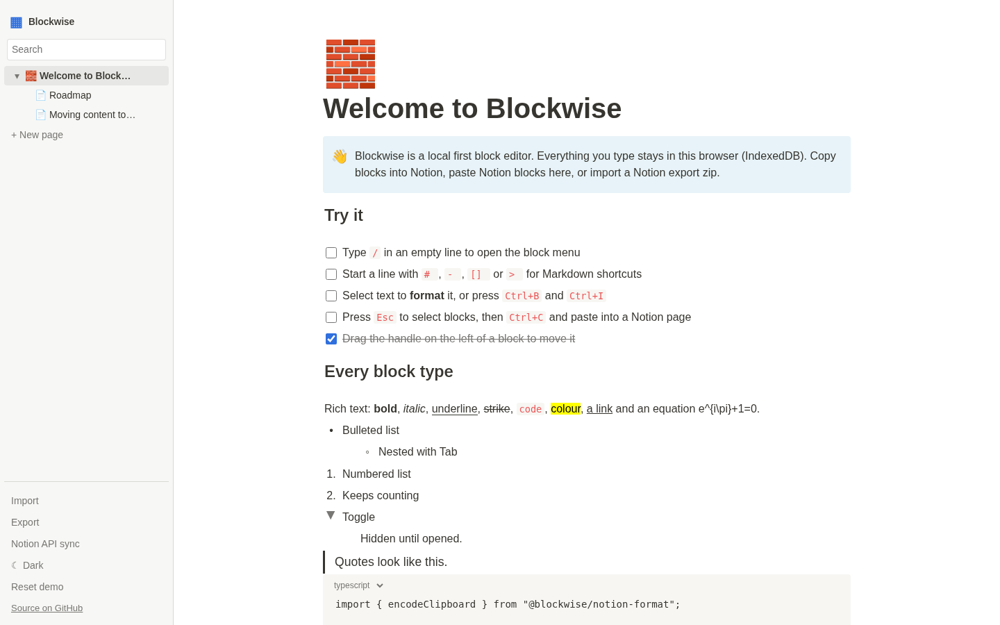

# Blockwise

A local first, open source block editor whose content moves cleanly to and from Notion: copy and paste blocks both ways, import and export Notion's Markdown, CSV and HTML archives, and optionally push or pull pages through the official API.

**Live demo:** https://blockwise-cyan.vercel.app



## Features

- Block editor with headings, lists, to-dos, toggles, quotes, callouts, code, equations, images, simple tables, columns, sub pages and inline databases
- Slash menu, Markdown shortcuts, inline formatting toolbar, drag to reorder, keyboard block selection, undo and redo
- Clipboard bridge: writes Notion's block payload plus HTML and plain text, and reads all three ([spec](docs/specs/clipboard.md))
- Import a Notion "Markdown & CSV" or "HTML" export zip, and export the same shapes back ([spec](docs/specs/export.md))
- Databases with typed properties, filter and sort, and Notion CSV round trips ([spec](docs/specs/database.md))
- Optional Notion API sync from the web app or a CLI, with your own integration secret ([spec](docs/specs/sync.md))
- Everything is stored in your browser (IndexedDB). Light and dark themes.

See the [compatibility matrix](docs/compatibility.md) and [limitations](docs/limitations.md).

## How the formats were derived

The clipboard schema was traced with REA in Notion 7.40.0's desktop app and the public web bundle it loads. Each artifact and analysis run is recorded with its SHA-256 in [`evidence/`](evidence/README.md), and `scripts/capture-evidence.sh` reproduces it. No Notion code or assets are included in this repository.

## Develop

```bash
pnpm install
pnpm build        # all packages and the web app
pnpm test         # Vitest
pnpm e2e          # Playwright
pnpm --filter @blockwise/web dev
```

Packages: `core` (document model), `notion-format` (clipboard, Markdown, HTML), `database`, `interop` (zip import and export), `notion-sync` (API and CLI), and `apps/web`. See [architecture](docs/architecture.md).

CLI sync, with a token you create at notion.so/profile/integrations:

```bash
NOTION_TOKEN=... pnpm --filter @blockwise/notion-sync exec blockwise-sync pull <page-url> page.json
```

## Not affiliated

Blockwise is an independent project. It is not affiliated with or endorsed by Notion Labs, Inc. "Notion" is a trademark of its owner and is used here only to describe compatibility.

## License

[MIT](LICENSE)
