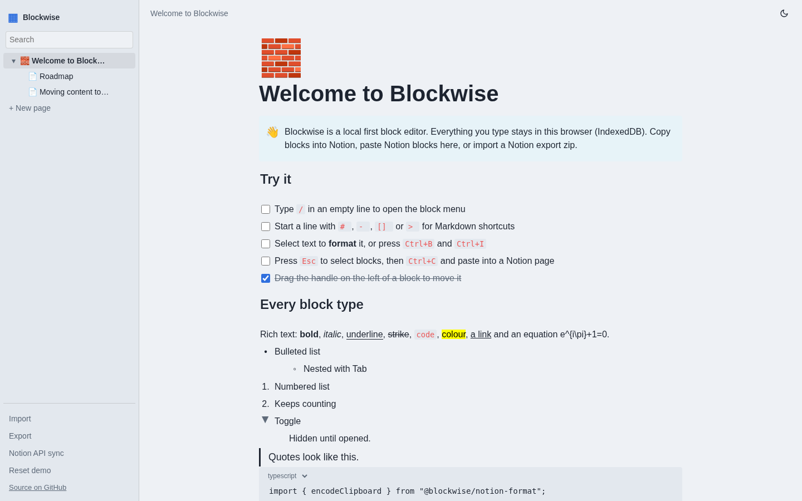
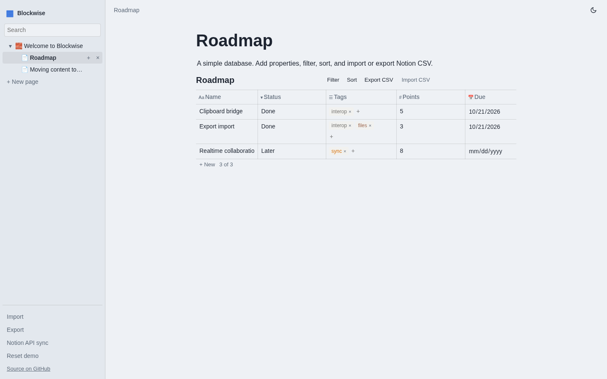
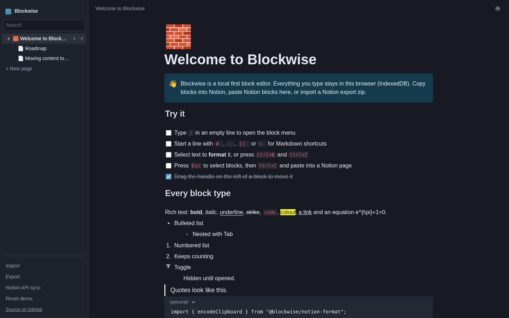
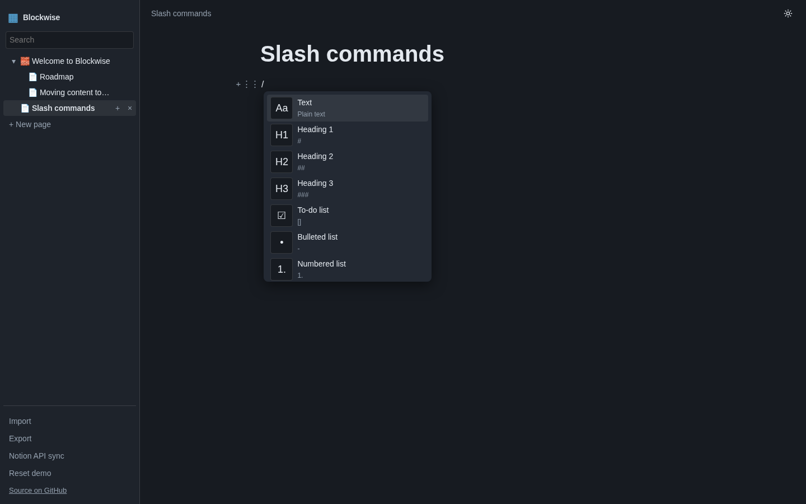

# Blockwise

A local first, open source block editor whose content moves cleanly to and from Notion.

[](https://blockwise-cyan.vercel.app)
[](https://github.com/devtechedge/blockwise/actions/workflows/ci.yml)
[](https://nextjs.org/)
[](https://www.typescriptlang.org/)
[](LICENSE)

---

## Live Demo

**https://blockwise-cyan.vercel.app**

> **Status:** Fully client side. Pages are stored in your own browser (IndexedDB) and start from a small demo workspace; use "Reset demo" to restore it. Nothing is sent anywhere unless you export a file or use the optional Notion API sync with your own integration secret.

---

## Screenshots

| Editor | Database |
|--------|----------|
|  |  |

| Dark mode | Slash menu |
|-----------|------------|
|  |  |

---

## Features

- **Block editor**: headings, lists, to-dos, toggles, quotes, callouts, code, equations, images, simple tables, columns, sub pages and inline databases
- **Fast editing**: slash menu, Markdown shortcuts, inline formatting toolbar, drag to reorder, keyboard block selection, undo and redo
- **Clipboard bridge**: copies blocks as Notion friendly HTML and Markdown, and pastes Notion's own block data, HTML or text ([format spec](docs/specs/clipboard.md))
- **Import and export**: Notion "Markdown & CSV" and "HTML" export zips, in both directions ([format spec](docs/specs/export.md))
- **Databases**: typed properties, filters, sorts and Notion CSV round trips ([spec](docs/specs/database.md))
- **Optional API sync**: push or pull pages with the official Notion API from the app or a CLI ([spec](docs/specs/sync.md))
- Light and dark themes, autosave, works offline after first load

See the [compatibility matrix](docs/compatibility.md) and the [known limitations](docs/limitations.md).

---

## Tech Stack

| Layer | Technology |
|-------|------------|
| Frontend | Next.js 15 (App Router), React 19, TypeScript |
| Editor core | Framework free TypeScript packages: document model, formats, databases, interop, sync |
| Data | IndexedDB in the browser, zip archives via fflate |
| Sync | `@notionhq/client` through a page and block only pass-through route |
| Tests | Vitest (108 unit tests), Playwright (13 end to end tests) |
| Hosting | Vercel |
| CI | GitHub Actions |

---

## Quick start

```bash
pnpm install
pnpm build
pnpm --filter @blockwise/web dev     # http://localhost:3000
pnpm test                            # unit tests
pnpm e2e                             # Playwright
```

CLI sync with your own integration secret:

```bash
NOTION_TOKEN=... pnpm --filter @blockwise/notion-sync exec blockwise-sync pull <page-url> page.json
```

---

## How the formats were derived

The clipboard schema was traced in Notion's desktop app and the public web bundle it loads. Every artifact and analysis run is recorded with its SHA-256 in the [evidence log](evidence/README.md), together with a script that reproduces it. No Notion code or assets are included.

Blockwise is an independent project. It is not affiliated with or endorsed by Notion Labs, Inc. "Notion" is a trademark of its owner and is used here only to describe compatibility.

## License

[MIT](LICENSE)
